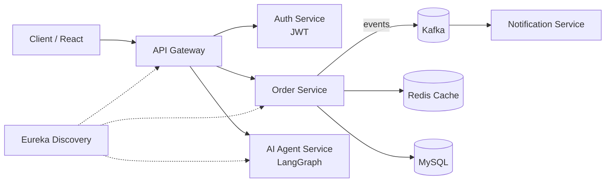

<!-- ═══════════════ HEADER ═══════════════ -->
<div align="center">


<a href="https://github.com/KeshavMittal1207">
  
</a>

<br/>

[](https://keshav-dynamic-portfolio.vercel.app/)
[](https://www.linkedin.com/in/keshav-mittal-8b2b81284/)
[](https://leetcode.com/u/keshav06/)


</div>

---

## 👨‍💻 About Me

```java
public class Keshav {

    private final String role      = "Java Backend + Agentic AI Engineer";
    private final String education = "B.Tech CSE (Final Year)";
    private final String focus     = "Microservices · Distributed Systems · LLM Agents";

    public String currentlyBuilding() {
        return "Production-style agentic workflows & event-driven backends";
    }

    public String lookingFor() {
        return "Backend / AI engineering roles (fresher) at product & IT-services teams";
    }
}
```

- ☕ I build **Spring Boot microservices** — Kafka, Redis, Eureka, API Gateway, JWT auth, Docker, MySQL.
- 🤖 I build **agentic AI systems** — LangGraph state machines, LangChain, RAG pipelines, evaluator-optimizer loops, human-in-the-loop flows.
- 🌉 My sweet spot is the bridge: **reliable backend engineering + LLM-powered agents** that actually ship.
- 🧩 Practicing DSA consistently on [LeetCode](https://leetcode.com/u/keshav06/).
- 📫 Reach me via [LinkedIn](https://www.linkedin.com/in/keshav-mittal-8b2b81284/) or my [portfolio](https://keshav-dynamic-portfolio.vercel.app/).

---

## 🛠️ Tech Arsenal

<div align="center">

**Languages**


**Backend & Microservices**


**Agentic AI & LLMs**


**Databases, DevOps & Tools**


**Frontend**


</div>

---

## 🚀 Featured Projects

<table>
  <tr>
    <td width="50%" valign="top">
      <h3>🎥 YouTube-to-Blog Agent</h3>
      <p>Human-in-the-loop agentic workflow that turns a YouTube video into a publication-ready, SEO-optimized blog and can publish it to Dev.to.</p>
      <ul>
        <li>🔁 Evaluator-Optimizer reflection loop with Pydantic-structured scoring (readability + SEO)</li>
        <li>⏸️ Native LangGraph <code>interrupt</code> + <code>Command</code> for Publish / Revise / Stop</li>
        <li>⚡ Groq LLaMA 3.1 for low-latency generation</li>
        <li>💻 Streamlit UI + FastAPI REST service, containerized with Docker</li>
      </ul>
      <p><b>Stack:</b> <code>Python</code> <code>LangGraph</code> <code>LangChain</code> <code>Groq</code> <code>FastAPI</code> <code>Streamlit</code> <code>Docker</code></p>
      <a href="https://github.com/KeshavMittal1207/youtube-to-blog-langgraph-agent">🔗 View Repository</a>
    </td>
    <td width="50%" valign="top">
      <h3>📧 Auto Mail Agent</h3>
      <p>LangGraph-based AI agent that watches the inbox for new mails containing a specific keyword and automatically drafts and sends replies.</p>
      <ul>
        <li>🤖 Agent-driven mail triage and auto-response</li>
        <li>🔎 Keyword-based detection of relevant emails</li>
        <li>🕸️ Stateful graph workflow built on LangGraph</li>
      </ul>
      <p><b>Stack:</b> <code>Python</code> <code>LangGraph</code> <code>LangChain</code></p>
      <a href="https://github.com/KeshavMittal1207/auto-mail-agent">🔗 View Repository</a>
    </td>
  </tr>
  <tr>
    <td width="50%" valign="top">
      <h3>🍔 Urban Bites — Food Delivery System</h3>
      <p>Full-stack food ordering platform built as my summer training project.</p>
      <ul>
        <li>🛒 Browse menu, cart and order flow</li>
        <li>🔐 Authentication and role-based access</li>
        <li>🏗️ Evolving the backend toward Java / Spring Boot with a React frontend</li>
      </ul>
      <p><b>Stack:</b> <code>JavaScript</code> <code>React</code> <code>Spring Boot</code> <code>MySQL</code></p>
      <a href="https://github.com/KeshavMittal1207/urban-bites-food-delivery-system">🔗 View Repository</a>
    </td>
    <td width="50%" valign="top">
      <h3>📦 InvenTrack — Smart Inventory Management</h3>
      <p>Inventory management application to track stock, products and movement in one place.</p>
      <ul>
        <li>📊 Real-time stock visibility</li>
        <li>🗂️ Product and inventory CRUD workflows</li>
      </ul>
      <p><b>Stack:</b> <code>JavaScript</code></p>
      <a href="https://github.com/KeshavMittal1207/inventrack-smart-inventory-management-application">🔗 View Repository</a>
    </td>
  </tr>
  <tr>
    <td width="50%" valign="top">
      <h3>🌐 Dynamic Portfolio</h3>
      <p>My personal portfolio — a responsive, animated site showcasing projects, skills and contact info.</p>
      <p><b>Stack:</b> <code>JavaScript</code> <code>Vercel</code></p>
      <a href="https://keshav-dynamic-portfolio.vercel.app/">🔗 Live Site</a> · <a href="https://github.com/KeshavMittal1207/keshav-dynamic-portfolio">Source</a>
    </td>
    <td width="50%" valign="top">
      <h3>🤝 SkillSync <sub>(contributor)</sub></h3>
      <p>Collaborative project I forked and contributed to — part of what earned me the Pull Shark badge.</p>
      <p><b>Stack:</b> <code>JavaScript</code></p>
      <a href="https://github.com/KeshavMittal1207/SkillSync">🔗 View Repository</a>
    </td>
  </tr>
</table>

---

## 🏗️ How I Think About Architecture



---

## 📊 GitHub Stats

<div align="center">


</div>

---

## 🧠 LeetCode

<div align="center">

<a href="https://leetcode.com/u/keshav06/">
  
</a>

</div>

---

## 🏆 Achievements

<div align="center">


</div>

- 🦈 **Pull Shark** — earned the GitHub achievement for merged pull requests
- 🤖 Built a **production-style human-in-the-loop agentic AI system** with LangGraph interrupts, checkpoints and a reflection loop
- 🧩 Consistent problem solving on **LeetCode** — [@keshav06](https://leetcode.com/u/keshav06/)

<div align="center">


</div>

---

## 🐍 Contribution Snake

<div align="center">

<picture>
  <source media="(prefers-color-scheme: dark)" srcset="https://raw.githubusercontent.com/KeshavMittal1207/KeshavMittal1207/output/github-snake-dark.svg" />
  <source media="(prefers-color-scheme: light)" srcset="https://raw.githubusercontent.com/KeshavMittal1207/KeshavMittal1207/output/github-snake.svg" />
  
</picture>

</div>

<sub>↑ Needs the one-time GitHub Action described below. Delete this section if you don't want it.</sub>

---

## 🎯 Currently

| | |
|---|---|
| 🔭 **Building** | Spring Boot microservices + agentic AI projects |
| 🌱 **Learning** | Advanced LangGraph patterns, RAG, system design |
| 🧗 **Practicing** | DSA on LeetCode |
| 💼 **Open to** | Backend / AI engineering roles (fresher) |

---

## 🤝 Let's Connect

<div align="center">

[](https://keshav-dynamic-portfolio.vercel.app/)
[](https://www.linkedin.com/in/keshav-mittal-8b2b81284/)
[](https://leetcode.com/u/keshav06/)

<br/>

*"Make it work, make it right, make it fast — then let an agent do the boring parts."*


</div>
